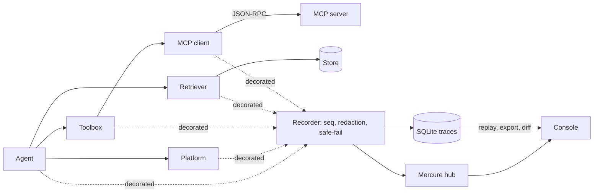

# Live Prompt X-Ray

**A realtime visual debugger for Symfony AI agents and MCP.** Type a prompt and watch the agent think:
a live graph lights up as the model, tools, the docs store and MCP servers work; tokens stream; every step
lands on a waterfall; the real JSON-RPC frames of every MCP call are one click away. Every run is recorded as
a trace you can replay, export and diff.

> X-Ray is to Symfony AI what the Symfony Profiler is to HTTP requests.

Built for the Symfony AI & MCP Hackathon 2026 on `symfony/ai-*` 1.0.0-BETA1, `symfony/mcp-bundle` 1.0.0-BETA1
and `mcp/sdk` 0.9.

## Why

Agents are black boxes. Why did it call that tool? What context did it actually see? Why was it slow? Which
MCP call failed, and did the retry work? X-Ray answers these by instrumenting the real `Agent`, `Platform`,
`Toolbox`, retriever and MCP client of a Symfony AI app (no patching, no mocks pretending to be real) and drawing
what happens, as it happens.

## Quickstart (about a minute)

Requirements: Docker (Docker Desktop on Windows and macOS). Nothing else, no API key.

```bash
git clone <this repository> live-prompt-xray && cd live-prompt-xray
docker compose up -d
```

Open **http://localhost:8090** (it redirects to the console at `/_xray`). The first start installs the Composer
dependencies inside the container; `docker compose logs -f app` shows progress. Pick a scenario and press Run.

`make up` (macOS/Linux) and `./dev.ps1 up` (Windows PowerShell) do the same.

## What you can try

**1. Just start typing.** Before you send anything, the **pre-flight X-Ray** reads your draft on every keystroke:
it runs the agent's real input processors (system prompt, RAG) without calling the model and shows

- the exact context the model will receive, as a budget bar: your message, the conversation so far, what each
  processor added (`SystemPrompt +61`, `DocsContext +158`…) and the tool definitions, against the context window;
- the documents the retrieval finds, with their distances, and which ones get injected into the prompt;
- the tool calls the model will make (exact in Demo Mode, e.g. `calculate("240 * 0.18")`) or, with a real model,
  the tools ranked by keyword match;
- a ghost graph: every tool and store the agent has, the planned path highlighted and pulsing.

**2. Send it.** Watch the agent think live: packets fly to the model, the docs store, local tools and the MCP
server; the answer streams; every step lands on the waterfall; the real JSON-RPC frames are one click away.

**3. Keep talking.** It is a chat: each follow-up carries the conversation, and the X-Ray shows it growing in the
context. **New chat** starts over.

Things to type in Demo Mode (no key needed): *"What's the weather in Tokyo on Saturday and what is 15% tip on 86?"*
(two tools at once), *"Will it rain in Lahore today? Also check service 7"* (a failure, a retry, the recovery),
*"Do I need an umbrella?"* (no city: it reads your notes first), *"What is our refund policy for annual plans?"*
(RAG with citations), or pick a showcase from **Scenario**.

Then open **Runs** to replay a run at 0.5x–4x (with a scrub bar), export it as JSON, drop a trace file on the
page to import it, or tick two runs and **Compare** them. Try *"Do I need an umbrella?"* against *"Do I need an
umbrella in Paris tomorrow?"*: the diff shows where the runs diverge and what it cost.

## Demo model or any real model

**Demo Mode** (default) needs no key: only the model is simulated. `ScriptedPlatform` is a real Symfony AI
`PlatformInterface`; for any prompt a rules-based planner (`app/src/Platform/DemoPlanner.php`) picks the tools
(several at once when you ask for several things), reacts to their real results (retries failures, follows up on
what your notes say) and writes the answer from them. The agent, toolbox, MCP client and server, docs store,
recorder and UI are all real. The console says so ("Demo mode: scripted model"), and token counts are marked as
estimates because rules have no tokenizer.

**Connect a real model** from the console: click the model badge at the top, pick a provider (OpenAI,
OpenRouter, Groq, Google Gemini, Mistral, DeepSeek, Together, or a local Ollama / LM Studio), paste a key,
**Test connection** (it lists the models the key can use), **Save and use**. Any OpenAI-compatible chat API
works through Symfony AI's generic bridge; the key is stored on the server (in the Docker volume, never in git)
and never sent back to the browser. Real providers report real token usage, so the token meters stop being
estimates. **Back to the demo model** disconnects.

## Add X-Ray to your own Symfony AI app

```bash
composer require --dev xray/xray-bundle
```

```yaml
# config/routes/xray.yaml
when@dev:
    xray:
        resource: '@XRayBundle/config/routes.php'
```

Open `/_xray` and run your agent. That's it: the bundle decorates the services Symfony AI and the MCP bundle
already tag. See [lib/xray-bundle/README.md](lib/xray-bundle/README.md) for the configuration reference,
endpoints and transports (Mercure, or Server-Sent Events from the trace store with no hub at all).

## How it works



- Every hook is a service decorator applied by a compiler pass; nothing in vendor is patched.
- X-Ray can never break a run: recorder, store and transport failures are caught and logged.
- Secrets are redacted before events are stored or published.
- Events carry `seq` and `ts`; the console re-orders and de-duplicates them, and live and replay share one code path.

Details: [docs/ARCHITECTURE.md](docs/ARCHITECTURE.md) · wire format: [docs/TRACE_SCHEMA.md](docs/TRACE_SCHEMA.md) ·
what we learned about the betas: [docs/FEEDBACK.md](docs/FEEDBACK.md).

## Security notes

- The console has no authentication and shows prompts, tool arguments and results: it is a development tool.
  Register the bundle for `dev` only, or protect `^/_xray` with your firewall.
- Values under keys like `api_key`, `authorization`, `token`, `secret`, `password` (configurable), Bearer
  credentials and `sk-`/`hf_`/`ghp_`-style keys are redacted **before** anything is stored or published.
- The bundled Mercure hub accepts anonymous subscribers and ships a development JWT secret; set your own
  `MERCURE_JWT_SECRET` in `.env` before exposing the port beyond your machine.
- The demo MCP server only accepts `localhost` (the mcp-bundle default).

## Development

| make | Windows | |
|---|---|---|
| `make up` | `./dev.ps1 up` | build and start |
| `make down` | `./dev.ps1 down` | stop |
| `make test` | `./dev.ps1 test` | PHPUnit: unit, integration (real agent + MCP over STDIO), functional |
| `make stan` | `./dev.ps1 stan` | PHPStan level 8 |
| `make cs` | `./dev.ps1 cs` | PHP-CS-Fixer (Symfony rules), dry run |
| `make console c="…"` | `./dev.ps1 console …` | Symfony console |

Tests never call a model provider: the bundle's integration tests use Symfony AI's own `MockPlatformFactory`,
the app's use the scripted platform with the real MCP server as a STDIO child process.

## License

MIT, see [LICENSE](LICENSE).
