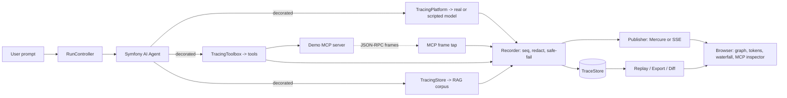

# Architecture

## Monorepo tree (target)

```
live-prompt-xray/
├── CLAUDE.md
├── README.md
├── LICENSE
├── Makefile
├── docker-compose.yml          # FrankenPHP (Mercure hub built in) preferred
├── Dockerfile
├── .env.example
├── phpstan.neon
├── .php-cs-fixer.dist.php
├── lib/
│   └── xray-bundle/
│       ├── composer.json
│       ├── README.md           # 5-line install guide
│       ├── config/
│       │   ├── services.php
│       │   └── routes.php      # /_xray/*
│       ├── src/
│       │   ├── XRayBundle.php
│       │   ├── DependencyInjection/        # Configuration, Extension, compiler passes
│       │   ├── Event/                      # typed trace events (see TRACE_SCHEMA.md)
│       │   │   ├── TraceEvent.php          # interface / base
│       │   │   ├── RunStarted.php
│       │   │   ├── PromptSent.php
│       │   │   ├── TokenChunk.php
│       │   │   ├── ToolCallRequested.php
│       │   │   ├── ToolCallStarted.php
│       │   │   ├── ToolCallFinished.php
│       │   │   ├── McpFrame.php
│       │   │   ├── RetrievalHit.php
│       │   │   ├── UsageReported.php
│       │   │   ├── RunError.php
│       │   │   └── RunFinished.php
│       │   ├── Recorder/
│       │   │   ├── Recorder.php            # seq numbers, run ids, safe-failure
│       │   │   ├── Redactor.php
│       │   │   └── RunContext.php
│       │   ├── Instrumentation/
│       │   │   ├── TracingPlatform.php     # decorates PlatformInterface
│       │   │   ├── TracingToolbox.php      # decorates the Toolbox
│       │   │   ├── TracingStore.php        # decorates Store(s)
│       │   │   ├── AgentRunListener.php    # lifecycle (processors/events)
│       │   │   └── Mcp/                    # JSON-RPC frame tap (transport/handler level)
│       │   ├── Transport/
│       │   │   ├── EventPublisher.php      # interface
│       │   │   ├── MercurePublisher.php
│       │   │   └── SsePublisher.php        # fallback
│       │   ├── Storage/
│       │   │   ├── TraceStore.php          # interface
│       │   │   └── SqliteTraceStore.php
│       │   ├── Replay/ReplayStreamer.php   # replays a stored trace at speed N
│       │   ├── Diff/TraceDiffer.php
│       │   ├── Pricing/CostEstimator.php   # configurable per-model price table
│       │   ├── Controller/
│       │   │   ├── ConsoleController.php   # /_xray (main UI)
│       │   │   ├── StreamController.php    # live + replay streams
│       │   │   └── TraceController.php     # export/import/list/diff
│       │   └── Resources/
│       │       ├── views/                  # Twig
│       │       └── assets/                 # Stimulus controllers, css, vendored JS
│       └── tests/
├── app/                                    # demo app
│   ├── composer.json
│   ├── config/packages/{ai,mcp,xray,mercure}.yaml
│   ├── src/
│   │   ├── Agent/DemoAgentFactory.php
│   │   ├── Platform/ScriptedPlatform.php   # fake model with streaming + tool calls
│   │   ├── Tool/{Weather,Notes,Calculator,SlowTool,FlakyTool}.php
│   │   ├── Mcp/DemoMcpServer.php           # #[McpTool] services
│   │   ├── Rag/{CorpusLoader,DocsStore}.php
│   │   └── Controller/{ScenarioController,RunController}.php
│   ├── scripted/                           # JSON scripts per scenario for ScriptedPlatform
│   ├── corpus/                             # small markdown docs for the RAG demo
│   └── tests/
└── docs/
    ├── ARCHITECTURE.md
    ├── TRACE_SCHEMA.md
    ├── UI_SPEC.md
    ├── DEMO_SCENARIOS.md
    ├── FEEDBACK.md
    ├── VIDEO_SCRIPT.md
    └── SUBMISSION_CHECKLIST.md
```

## Data flow



## Key decisions
- **Decoration over patching**: everything is added via service decoration/listeners so the bundle works in any app.
- **Safe-failure**: `Recorder::emit()` catches everything; agent runs never break because of X-Ray.
- **Order**: events carry `runId`, `seq`, `ts` (monotonic ms from run start). The client sorts by `seq` and drops duplicates.
- **Redaction before publish**: the `Redactor` rewrites payloads before storage and transport.
- **Realtime transport: Mercure** (decided 2026-11-19 after the Phase 0 spike). FrankenPHP 1.13.5 ships the hub;
  `symfony/mercure-bundle` 0.3.9 publishes to `http://localhost/.well-known/mercure`, the browser subscribes with
  `EventSource` to topic `xray/runs/{runId}`. Measured publish-to-render latency in the browser: 8–32 ms.
  The hub runs with `protocol_version_compatibility 8` because the Symfony Mercure client signs HS256 publisher JWTs
  (the newer Mercure module refuses `publisher_jwt` otherwise). Subscriptions are anonymous: only redacted events
  reach the hub. Two concurrent publishes arrived out of order in the spike, so the client re-orders by `seq`.
  SSE from a streaming controller stays the fallback for apps that don't run a Mercure hub (Phase 4).
- **Demo Mode**: only the model is scripted. Tools, MCP, RAG, recorder and UI are real.
- **Disable switch**: `xray.enabled: false` removes all decorators from the container.
